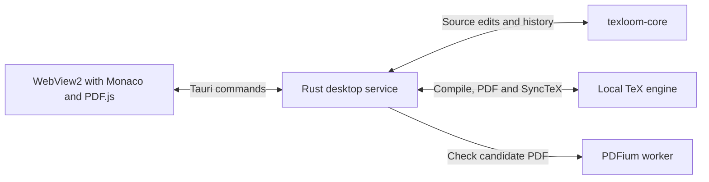

# Texloom

Texloom is a Windows LaTeX editor with a live PDF canvas. Compile a project locally, then edit supported text in the PDF and save the changes directly to your LaTeX source.

**v0.3 · Active development**

## Quick setup on Windows

1. Clone or download this repository. Install the prerequisites under [Build and test on Windows](#build-and-test-on-windows).
2. Install MiKTeX or TeX Live and make sure the `geometry` package is available.
3. Run `Build-Portable.cmd` from the repository folder. Extract the ZIP it creates and launch `Texloom.exe` from the extracted folder.
4. Click **Compile** to try the bundled example.

## Edit a LaTeX project

1. Open the project's main `.tex` file and compile it. The editor and PDF preview sit side by side.
2. Select supported text in the PDF to edit it or move a single typeset line. **Show in PDF** takes you from the source cursor to the compiled page. Use **+ Paragraph** to add ordinary LaTeX text.
3. Save the project to write the LaTeX files, or export the compiled PDF.

## How visual edits work



A visual edit starts as a proposed source patch. Texloom builds it in a private snapshot and checks the resulting PDF before committing the change as one undo step. If the check fails, the editor keeps the existing source and the last successful PDF.

- **Source mapping.** SyncTeX helps locate source for rendered text. Private builds confirm the selected occurrence, and offset conversion maps Monaco’s UTF-16 positions to Rust’s UTF-8 ranges.
- **Local compilation.** A cancellable Rust service runs pdfLaTeX, XeLaTeX or LuaLaTeX, with BibTeX and Biber recipes for projects that need them.
- **Typed commands.** Rust-generated TypeScript types describe the editor and desktop command boundary. The app checks incoming data at runtime.
- **Recovery and Save.** Save checks for external file edits before writing the project and can recover an interrupted write.

## Current scope

- Visual editing covers supported text on a single page and certain layout parameters. Use the source editor for math, TikZ and macros outside that scope.
- Current language coverage focuses on English, Arabic and Hebrew.
- The [validation record](VALIDATION.md), [implementation status](docs/IMPLEMENTATION-STATUS.md) and [remaining work](docs/REMAINING-WORK.md) describe the tested workflows and open checks.
- The [research workspace](research/README.md) contains the technical report draft, development experiments and evaluation plan. See the [roadmap](https://github.com/nadeemtsf/texloom/issues/44) for planned app work.

## Build and test on Windows

Install [Node.js](https://nodejs.org/) 22.13 or newer and [Microsoft C++ Build Tools](https://visualstudio.microsoft.com/visual-cpp-build-tools/) with **Desktop development with C++** and a Windows SDK. The build scripts can set up Rust locally when needed.

- Run `Build-Portable.cmd` to build the portable ZIP.
- Run `Build-Desktop.cmd` to build the NSIS setup executable.

Use the complete [portable package](docs/PORTABLE-PACKAGING.md) so the app has its matching verifier files. Running the desktop app requires WebView2 and a local TeX distribution.

Run the frontend suite and Rust core checks from the repository root.

```powershell
npm.cmd ci
npm.cmd test
powershell -NoProfile -ExecutionPolicy Bypass -File .\Build-Desktop.ps1 -CoreOnly
```

## Project layout

| Directory | What it contains |
| --- | --- |
| `crates/texloom-core/` | LaTeX parsing, source edits and document history |
| `crates/texloom-build/` | Compiler jobs, filesystem operations and independent PDF inspection |
| `src-tauri/` | Windows app, Rust desktop service and native commands |
| `web/` | Monaco editor, PDF canvas and interface |
| `tests/` | Frontend regressions and fixtures |
| `research/` | Technical report, experimental methods and evidence |

## License

Current Texloom source is public for inspection. All rights reserved. See [LICENSE](LICENSE) for permissions, third-party components and earlier MIT-licensed revisions.
