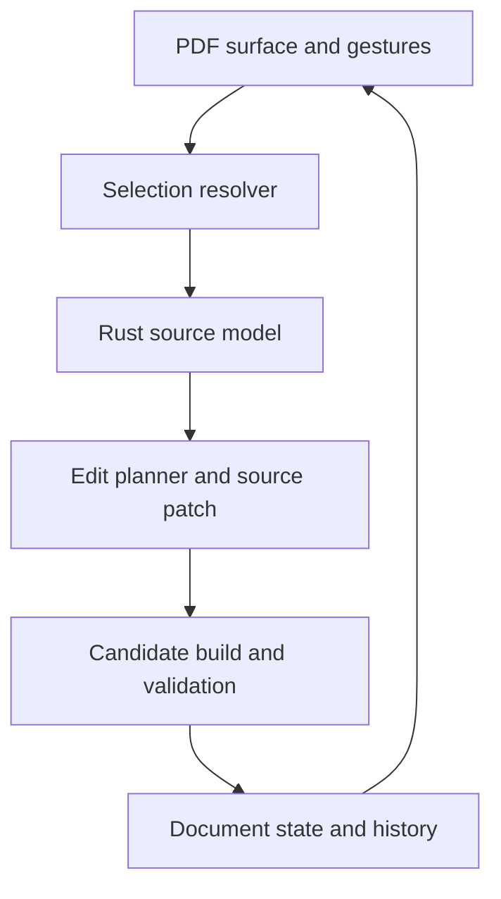

# Texloom visual editing system

7 November architecture-planning follow-up: this document records the earlier bounded movement design. The broader Word-like visual authoring proposal is in [architecture/README.md](architecture/README.md), including source-native edits, generalized Delete, future caret/input and the shared foundation needed first. That proposal has not been implemented; current runtime behavior and named-version evidence remain separate. Do not treat the wrapper-based model below as the required universal identity for future editing.

Status: implementation plan and acceptance contract, 30 October 2026.

## 1. Product contract

Texloom is a local Windows editor for LaTeX documents that need careful visual adjustments. The primary interaction is selecting visible text, obtaining an object frame, moving the selection, and editing its content. Source remains the authoritative document. A successful compiler exit is necessary but insufficient: the candidate PDF must also parse and pass the operation's layout checks before an edit becomes part of document history.

The first supported use cases are signature lines, short text groups, headings, and ordinary prose paragraphs. Existing positioned StudioBlock documents retain their width/font controls. An ordinary wrapped paragraph is selected as a logical paragraph when a rendered line cannot safely be separated from its source. The selection frame must show this expansion before the user moves it. Unsupported macros, generated content, cross-page selections, and ambiguous source mappings receive an explanation and a source-editing fallback.

No promise is made to reverse arbitrary LaTeX into a complete page-design object model. Tables, floats, diagrams, bibliography tools, and arbitrary package adapters require separate capabilities and acceptance fixtures. Their presence must not corrupt supported text operations.

## 2. Requirements and invariants

1. Open a normal .tex project; no mandatory conversion into an app-owned format.
2. Click a visible text line to select its source unit. Shift-click or draw a rectangle to select adjacent compatible lines. Selection is reversible and does not modify source.
3. Drag the selected frame with immediate visual feedback. Pointer cancellation and Escape restore the existing preview. Compile only after release.
4. Move ordinary text without removing its space in document flow, changing its font, or flattening its LaTeX formatting. Existing source-defined positioning remains a separate operation.
5. Edit selected content through a modal, preserving LaTeX commands. The source preview clearly identifies formatted content. Plain text input is escaped before insertion.
6. Maintain one shared undo/redo history for source edits and successful visual transactions.
7. Reject stale mapping or compilation results. A selection belongs to one project, source revision, successful build, and physical PDF page.
8. Reject a candidate if selected content crosses pages, goes outside the physical page, loses its object markers, or changes the page count during a position-only move.
9. Preserve the last good PDF and original buffers when any candidate fails. A candidate is not added to history before PDF validation completes.
10. Save is explicit. Originals are written only by Save; native compiler inputs are private build snapshots.

## 3. Architecture



### Rust domain layer

The dependency-free texloom-core crate owns lossless source ranges, supported commands, environment/brace validation, and transformations. It must skip comments and literal environments, distinguish UTF-8 byte positions from editor UTF-16 positions, reject duplicate IDs, and replace only verified source ranges. A rendered selection never supplies arbitrary replacement offsets directly to disk operations.

New source entities:

- SourceUnit: source range, first/last source lines, content range, kind, capability, and reason when unsupported.
- TextObject: stable ID, relative horizontal/vertical offsets, content, complete macro range, and argument ranges.
- EditPlan: original source fingerprint/revision, target file, exact patch, operation kind, expected object IDs, expected page count, and validation policy.

Source-unit resolution starts with SyncTeX evidence and finds the smallest supported balanced source unit. A forced line break can delimit an individual signature line. Soft-wrapped prose remains a paragraph. Structural boundaries such as document begin/end, section containers, floats, display math, and verbatim material must not be silently swallowed into a guessed selection. A group must be contiguous in one file and must not include an unsupported gap.

### Native application services

The existing Rust/Tauri service remains responsible for project access, compiler jobs, engine selection, bounded logs/timeouts, build IDs, native dialogs, and PDF export. New narrow commands resolve source units and plan object transformations. These commands return candidates; they do not save files or mutate the current project.

Native source mapping remains read-only. SyncTeX gives evidence at source-line granularity, not a guaranteed character-level parse. The resolver therefore checks source structure and visible text before granting an editing capability. Mapping from an older successful build cannot be used after typing changes its source buffers.

### Frontend modules

- geometry.js: PDF-point rectangles, line grouping, intersections, hit testing, selection unions, and page-bound checks; no native or DOM calls.
- pdf-surface.js: PDF.js canvas/text layers, render cancellation, marked-content extraction, and object bounds from actual compiled output.
- canvas-controller.js: click/marquee/group selection, pointer capture, keyboard nudging, drag preview, and cancellation.
- document-session.js / transaction functions: revisions, prepared candidates, successful snapshots, undo/redo, and compile coalescing.
- app.js: application wiring, editor, native dialogs, status, inspector, and modal integration. New parsing and geometry logic must not accumulate as unrelated event-handler code here.

## 4. Source-preserving movement

Removing selected prose and appending an absolutely positioned block changes the document's text flow and formatting context. That is unsuitable as the default for imported documents.

The proposed text adapter wraps a verified source fragment in a portable macro:

```tex
\TexloomObject{signature-name}{0}{5}{\textbf{\RefName}}
```

Offsets are PDF points, positive right/down. The macro emits a local PDF translation and a marked-content identifier while allowing the original TeX material to retain its layout contribution. Engine-specific literal output is isolated in texloom-objects.sty. No external process, shell escape, or custom compiler is required. The chosen implementation must first pass zero-offset equivalence and unaffected-neighbor position tests under supported engines. If those checks fail, this adapter is not released merely because the PDF looks plausible.

The PDF marker identifies the actual output generated by that source object. PDF.js reads marked content and derives bounds from the transformed glyphs. Source IDs are therefore matched to compiled output without guessing from repeated text or hard-coded original page coordinates. When a preceding paragraph changes, the object follows its source location and its new bounds are read from the next compiled PDF.

The macro is a project dependency, included in compilation candidates and saved beside the source when needed. Detach/unmake removes the wrapper while retaining its original content. The editor must preserve existing versions of this dependency consistently rather than silently using an incompatible installed copy.

Risks to verify include PDF text-position caching, line breaks around PDF literals, nested objects, multi-page material, annotations/hyperlinks, bidi text, and engine-specific graphics-state handling. Hyperlinked or cross-page fragments can remain unsupported until verified. Arbitrary scaling is not applied to normal text: width/font changes need separate semantic adapters, while existing StudioBlock dimensions continue to work.

## 5. Selection and interaction rules

Select objects mode is the default editing surface; Read text provides ordinary text highlighting/copying. Both have explicit labels and a short persistent hint. Compile failures explain why layout editing is paused while preserving reading access.

On a normal PDF text click:

1. Capture project/build/revision/page identity and visible line geometry.
2. Ask native SyncTeX for source evidence at the line.
3. Resolve a safe source unit; verify it still belongs to the same source revision.
4. Match related PDF lines for that unit and show the complete selection frame and its capability label.
5. Allow dragging or editing the frame. Selection itself does not add a wrapper or a history entry.

A selected, previously wrapped object is resolved directly through its PDF marker. Repeated clicks do not rebuild the target DOM between the first and second click, so double-click editing remains reliable.

A marquee gathers visible text lines intersecting the rectangle. The group resolver verifies source contiguity and expands only balanced supported units. Cross-file, cross-column ambiguous, and cross-page selections are rejected with an explanation. The bounding frame is shown before any source change.

Dragging uses PDF points independent of screen DPI and zoom. Preview uses the already-rendered pixels/text region or a selection ghost; it performs no source writes and no compilation on pointermove. Release creates one edit plan. Arrow keys nudge; Shift increases the increment; Alt disables snapping. Escape/pointercancel removes the preview.

## 6. Transaction protocol

States: idle -> selecting -> selected -> previewing -> preparing -> compiling -> validating -> committed. Cancellation, stale identity, or failure returns to the last successful document state.

Prepare a complete immutable candidate snapshot including required .sty files. Compile it with a unique build ID and proposed revision. Parse the candidate PDF and compute marked object bounds offscreen. For a translation, check the target exists on exactly one physical page, remains inside its page, and preserves the number of pages. Check the session revision again after every asynchronous boundary, including PDF parsing/rendering. Only then atomically publish source, PDF, selection geometry, and one history entry.

If the user types while the candidate compiles, preserve the newer source and discard the older visual transaction. Coalesce a subsequent automatic compile; never overwrite typed content with an older candidate. Inspector Apply uses the same protocol as dragging. A failed PDF parse must preserve source/history just as a failed compiler exit does.

## 7. Project and repository design

The desktop source directory becomes the repository root. Keep application source, dependency locks, synthetic fixtures, tests, design decisions, build scripts, and CI definitions. Exclude installed compilers, node_modules, targets, rendered output, user letters, user projects, credentials, and local app-data/build snapshots.

Start with a private repository if the owner chooses to create one. A private repository is source hosting; it does not automatically create a public website or a Microsoft Store listing. Keep main as a verified baseline, develop changes on feature branches, and review the diff and CI checks before merging. Record build evidence per release. Local validation and a local commit do not count as a remote push.

GitHub Actions should run frontend/domain tests and a Windows Tauri production build from locked dependencies. Keep workflow permissions read-only. Provide manually requested build artifacts, not automatic public releases. No signing credentials are needed for unsigned development builds. Store signing and public distribution are later explicit release decisions. Private-runner allowances and billing depend on the owner's GitHub plan and must be checked before enabling sustained CI usage.

The current connector must be checked for repository-creation support. If it cannot create a repository, prepare everything locally and provide a concrete handoff; do not claim a remote repository exists.

## 8. Implementation milestones and gates

| Milestone | Deliverable | Acceptance gate |
| --- | --- | --- |
| M0 | Design, repository layout, fixture inventory | Plan saved; baseline preserved; no user document in repository |
| M1 | Source units, object parser, portable movement macro | Lossless transforms; zero-offset equivalence; supported engines move only intended glyphs |
| M2 | PDF line/object geometry and selection controller | Real PDF text can be selected; safe group frame shown; zoom/DPI transforms correct |
| M3 | Move/edit transactions and shared history | Real source/PDF round trip; invalid or stale candidate cannot commit; undo restores original |
| M4 | Compatibility and build hardening | Synthetic signatures, formatted text, macro calls, paragraphs, multiple files, and page-boundary cases tested |
| M5 | GitHub-ready source and Windows package | Automated checks/build; exact validation report; repository/CI status stated accurately |

Actual completion is tracked in IMPLEMENTATION-STATUS.md. A milestone stays pending when its acceptance gate has not run or fails. Existing earlier tests are retained but do not establish these new capabilities.

## 9. Test corpus and measurements

Use synthetic documents only: English signature with three forced lines; a long soft-wrapped paragraph; inline bold/italic text; a local macro that expands to a name; repeated identical labels; comments and escaped braces; Arabic/English text; a multi-file document; and a fragment near the page bottom.

Domain tests exercise boundaries, comments/literals, Unicode offsets, duplicate IDs, nested objects, unknown commands, and exact preservation of unrelated characters. Geometry tests exercise mixed-font lines, reading order, grouping, rectangle unions, marker nesting, rotations, and page bounds. Transaction tests exercise compiler failure, PDF parse failure, missing markers, page-count change, concurrent typing, project changes, and cancellation.

Native integration compares baseline/zero-offset/moved PDFs using extracted glyph positions and page counts. Verify actual object movement, unchanged neighbors, unchanged text, correct font sizes, and an independently recompilable exported project. The live application then gets real click/drag/edit/undo/save/reopen checks using a dedicated fixture project, never a user's active recommendation letter. Record tests that were blocked separately from tests that passed.

Performance targets are acceptance targets, not existing measurements: pointer preview should remain responsive within a frame on typical hardware; pointermove should trigger zero compiler jobs; release should trigger one candidate job; long builds must leave the UI responsive. Measure compiler duration separately from gesture latency.

## 10. Later adapters

After the text contract passes, add includegraphics width/aspect-ratio editing, caption/float placement controls, table column widths, Beamer object positions, and template-aware spacing. Each adapter needs its own grammar, capabilities, layout policy, fixtures, and undo behavior. Normal text movement never silently enables those unsupported operations.
