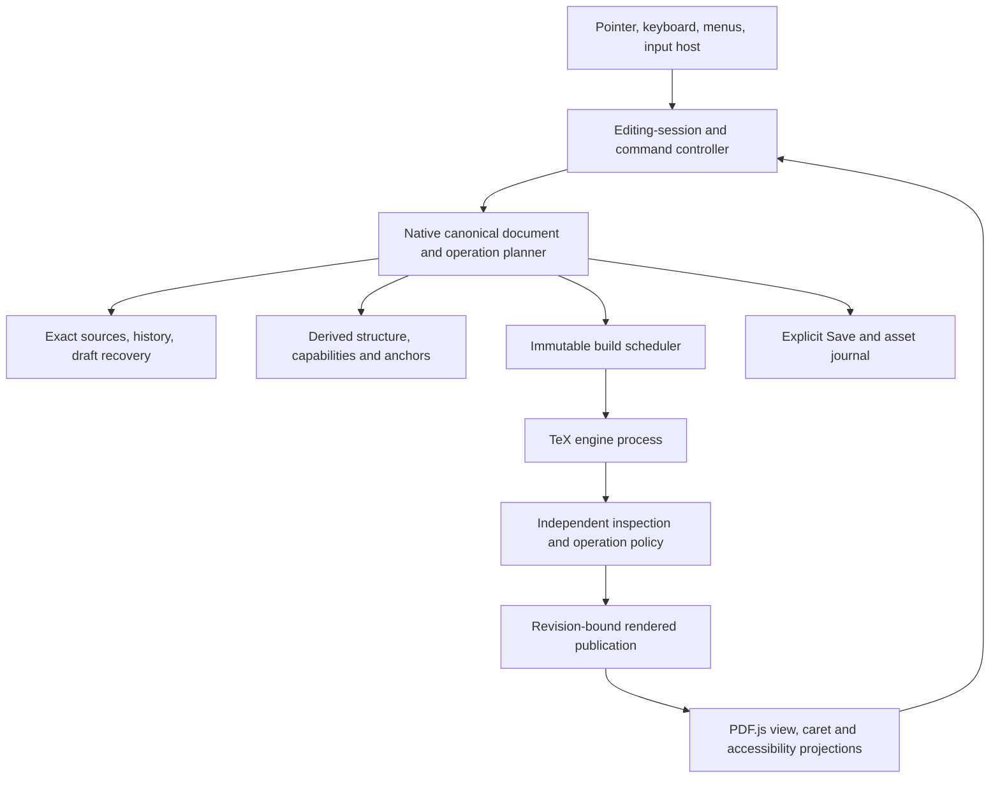
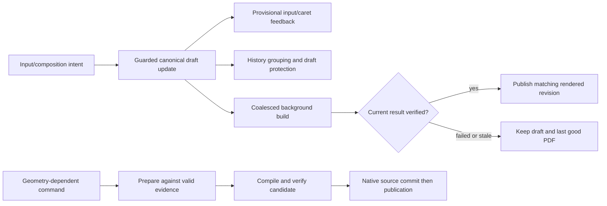

# Proposed architecture for a source-authoritative visual LaTeX editor

Status: proposed design, 7 November 2026. Current-source audit: `6f55baca3100ef8af48d0a3cadb419855c125339`. Implementation and native acceptance remain separate future work. See [standards and evidence](STANDARDS-AND-EVIDENCE.md) for verified sources and the distinction between standards and recommendations.

## 1. Architectural direction and alternatives

Retain a modular local application with the existing Rust domain, native application services, supervised build/inspection processes, and WebView frontend. Add missing editing boundaries incrementally. Neither microservices nor a wholesale rich-text framework replacement is justified by the audit.

Three alternatives were considered:

| Direction | Benefit | Consequence and decision |
| --- | --- | --- |
| Extend persistent movable wrappers into the universal document model | Reuses current marker identity and displacement checks | Makes unrelated editing depend on a generated source representation. Keep it as a compatibility adapter, not the universal identity mechanism. |
| Make an HTML/rich-text tree authoritative and export LaTeX | Mature editing frameworks can supply useful interaction behavior | Arbitrary user macros, comments, formatting, incomplete source and unsupported environments can be normalized or lost. Reject this as the default architecture for imported LaTeX. |
| Keep exact source authoritative and derive a partial editable projection | Preserves imported source while supporting progressively richer operations | Requires explicit anchors, capability rules, input integration and operation-specific verification. Recommended. |

A rope, piece table, incremental parser, EditContext integration or third-party editor library may become useful after measurement or a feasibility spike. None is an automatic prerequisite. A future collaboration system would introduce different consistency requirements; CRDT/OT is outside the current product scope.

## 2. Stakeholders, constraints and invariants

Users need familiar editing, understandable output, recoverable mistakes and honest feedback. Source-oriented collaborators need ordinary LaTeX and project portability. Maintainers need bounded modules and reproducible failures. Research readers need versioned, appropriately limited evidence. Assistive-technology users need an actual editing/navigation model beyond painted pixels.

Required invariants:

- The canonical document consists of source bytes, file identity/encoding information and asset references. Derived editor state must not silently rewrite it.
- An editable entity is not defined by having a Texloom macro. Unsupported source remains opaque and byte-preserved.
- Native services derive authorized changes from canonical state. A frontend source map, range, object ID or PDF coordinate is a proposal, not authority.
- A draft source revision, a prepared visual transaction and a verified rendered revision are different states.
- Every accepted source action has meaningful history and recovery behavior; source commit, PDF publication, presentation and Save have separate outcomes.
- Geometry-dependent actions use valid mapping evidence for the appropriate revision. Ambiguity invalidates a capability rather than selecting a nearby occurrence.
- Reordering, content deletion, spacing/reflow and drawing displacement have distinct allowed effects.
- New source-native saved operations avoid Texloom-specific macros/support files. This does not promise compilation without the document's normal dependencies.
- Failure, cancellation, stale work and uncertain acknowledgement preserve newer user work. Unknown commit status is resolved before retrying a potentially destructive command.

## 3. Modules and ownership

| Boundary | Responsibility | Excluded authority |
| --- | --- | --- |
| Domain/source core | Snapshots, safe ranges, lossless structure, anchors/change maps, typed operations, patches and history | Does not launch compilers or trust arbitrary PDF coordinates |
| Native application services | Project ownership, operation preparation, build orchestration, cancellation, approval, recovery and Save | Transport data cannot manufacture approval |
| Build/inspection infrastructure | Immutable snapshots, tool/output fingerprints, supervised jobs and bounded inspector evidence | A receipt is not permission to commit or proof of arbitrary document correctness |
| Frontend editing session | Logical selection/caret, input/composition, focus, intent dispatch and provisional feedback | No second authoritative document or independent undo stack |
| Preview projection | PDF rendering, hit regions, visual selection/caret geometry, virtualization and search | PDF text-layer spans are not an editable LaTeX document |
| Accessibility projection | Semantic navigation, input/selection state, command availability, focus and status | ARIA labels alone do not implement editing behavior |

Frontend extraction should follow ownership: project/session coordinator, command executor, selection/input session, preview lifecycle, inspector/dialog routing and history/recovery integration. Preserve existing pure geometry, protocol and transaction modules. Avoid extending the single `app.js` closure with another collection of unrelated state flags.

## 4. Derived structure and identity

Use a bounded, lossless structural projection over exact sources. Recognized entities can include literal spans, paragraphs, forced-line groups, headings, list items, image references, captions and later supported tables. Unknown macros, dynamic TeX behavior and unsupported environments remain opaque source regions. Opening incomplete source must remain possible.

Each entity needs a kind, source file/range or declared range set, scope/context, revision, relevant dependencies, capabilities per operation, and reasons for refusal. Being replaceable does not automatically make an entity reorderable or deletable as a balanced unit. A caption and label may need to move together; a macro invocation must not authorize changing its shared definition.

Positions need explicit types and conversions: UTF-8 source bytes, Monaco/JavaScript UTF-16 offsets, Unicode grapheme/word boundaries, logical document positions, and PDF page coordinates. Keep physical left/right distinct from logical before/after in bidi text. Anchor/head direction and caret affinity survive independently of a sorted selection range.

An anchor should identify project/file/revision, logical position/range, insertion bias, structural evidence and an invalidation policy. Optional contextual hashes or node keys help re-resolution; they do not authorize guessing. Changes before an anchor map it. Changes through its identity can invalidate it. Undo/redo map selection using the inverse change, not a stale DOM rectangle.

Rendered evidence additionally binds build/artifact identity, page and glyph/run correspondence. A valid numerical range alone does not establish a valid semantic target. Soft-wrapped PDF lines are not automatically separate LaTeX source units. Repeated text, macro expansion, ligatures and bidi shaping require explicit evidence or refusal.

Caret placement additionally needs a cluster-level geometry contract: logical grapheme boundaries, shaped/PDF glyph clusters and visual caret stops do not necessarily correspond one-to-one. The current whole-run bounds are insufficient evidence for every stop. Never estimate a caret by dividing a run's width by character count. The feasibility study must identify ambiguous or unavailable stops and define how those positions are represented or refused.

## 5. Typed operations and transaction contracts

The future intent vocabulary includes replacement, selection/entity deletion, source reordering, spacing/parameter adjustment, formatting, insertion, paragraph split/join and object-specific changes. Define the interfaces now; do not pretend every operation is implemented.

A proposed contract should include:

| Concept | Required information |
| --- | --- |
| Edit intent | Operation ID/type/version, base source revision, typed selection/anchor, payload and input-session identity |
| Preconditions | Project/file ownership, expected bytes/context, capability, read-set/dependency fingerprints and source/render evidence required by this operation |
| Derived plan | Exact patch set, allowed file/asset effects, inverse information, proposed selection mapping and effect contract |
| Outcome | Draft applied, prepared, refused, cancelled, source committed, commit unknown, rendered/published, or presentation failed |
| Evidence | Source and artifact identities, policy version, checks actually executed, failed/unresolved observations and Save state |

Use narrow native requests that can derive canonical source instead of repeatedly trusting full frontend source maps. Preserve existing IPC compatibility during staged migration. Schema generation and runtime validation must evolve together. Implement operation-ID handling for uncertain acknowledgement before adding automatic retries; a request ID by itself does not guarantee exactly-once effects.

Minimal patches should retain comments, whitespace, BOM/newlines and unrelated bytes. Reordering requires an atomic deletion/insertion plan with correct interpretation of offsets before and after deletion. Repeated spacing changes update one proved parameter; do not combine arbitrary user-authored commands based only on visual proximity.

Delete content, remove positioning, remove a reference, and delete a physical asset are separate commands. The default visual deletion of an image removes the source reference and retains potentially shared asset bytes.

## 6. Two editing lifecycles and responsive typing

The existing source-edit lane permits incomplete drafts without compile approval. The existing visual lane requires compilation/verification before accepting a geometry-dependent transformation. Keep both within one document/history authority.

Track draft revision, input-session/composition state, last verified render revision, pending candidate/build identity and current presentation state explicitly. The last good PDF may be stale while a user types. It cannot grant geometry authority for a newer draft unless a bounded revalidation establishes it.

A visual typing session needs a real input host and surrounding-text/selection integration, not only key handlers. Evaluate controlled editable-host and EditContext options on the actual WebView2 runtime. Keep their details behind an adapter. Do not mark the PDF.js text layer `contenteditable` and serialize its rendered spans as LaTeX.

The host's surrounding text is a bounded visible-text projection with a validated mapping to supported source spans. It is neither raw LaTeX nor a serialization of PDF spans. Specify markup/escaping, grapheme and bidi offset behavior; opaque or ambiguous macro expansion cannot grant an insertion/deletion capability. Some composition updates are noncancelable, so the adapter must reconcile actual host updates rather than assume `preventDefault()` controls every edit.

Composition updates must have coherent provisional behavior, cancellation and history grouping. Text input, selection replacement, paste, speech/input replacement where available and formatting commands should enter through intents. Plain text is escaped according to its LaTeX context; explicit raw-LaTeX input is a different mode. Temporarily invalid source retains its draft and recovery protection.

Cut spans two different systems. Preserve source if clipboard transfer fails or is cancelled, and revalidate the same source revision/selection before native deletion after an asynchronous transfer. If copying succeeds but deletion refuses, retain source and report copy-only completion. An uncertain deletion acknowledgement is resolved before retry, not automatically repeated.

Responsive local feedback is not a promise of instantaneous accurate PDF retypesetting. The input-host/provisional-layout spike must establish how a caret behaves during reflow, stale rendering and compile failure. If a proposed approach cannot maintain understandable interaction, revise the design before enabling inline typing. Do not invent a latency pass or weaken source checks to meet an unmeasured target.

## 7. Verification by operation family

| Family | Required source obligation | Render obligation and permitted change |
| --- | --- | --- |
| Replace text | Intended literal/context only; correct escaping and expected original | Expected replacement, no unintended omission/duplication; declared reflow allowed |
| Delete | Exact proved target removed once; delimiters/context remain valid | Intended content absent, unrelated content retained; declared reflow allowed |
| Reorder | Same source entity moved once to a legal destination | Intended order/identity, retained content; expected reflow/pagination assessed |
| Spacing/formatting | Only the supported parameter/format scope changes | Declared local/flow effect; no assumption of unchanged neighbors |
| Insert/split/join | Correct insertion anchor/context and preservation of adjacent source | Expected new content/structure and readable layout; no guessed blank-space insertion |
| Drawing displacement | Exact target, known offsets and isolation | Existing strict displacement contract only where applicable |
| Media/table operation | Supported source structure and staged asset/reference effects | Intended object/cell/caption result; family-specific invariants |

The current Semantic policy requires independently readable inspection, not a complete preservation proof. It must not become a catch-all certification path. Text multisets cannot establish reading order, formatting or the correct repeated occurrence. Runtime predicates and independent evaluation oracles also have different purposes.

Structural operations also need a declared dependent/generated-output effect set, not only permitted geometry/reflow. Removing or reordering a numbered item, heading or caption can legitimately change counters, cross-references and contents output away from the selected source. Preserve unrelated source bytes while checking those explicitly declared generated changes separately. Refuse operations whose dependencies/effects cannot be bounded; do not require unchanged rendered numbering and then silently waive the failure.

Private diagnostic instrumentation may remain an implementation option without leaking into canonical saved output. Its identity proof must apply to the uninstrumented artifact. Whether to forbid even private instrumentation is a separate decision. Marker-independent selection is a high-risk foundation task, not a string-replacement cleanup.

## 8. History, assets, Save and external editing

One command should have one coherent undo unit, with explicit typing/composition grouping rules. Selection changes, caret restoration and associated asset references accompany history. Do not accidentally create another history owner in an input host.

Source text history currently does not fully model media lifecycle. Stage imports, track owned asset identity and references, and define cancellation/Undo/Redo/Save/recovery behavior before promising image editing. Unknown/shared references prevent automatic asset garbage collection. A user deleting a displayed image must not silently erase a file used elsewhere.

Retain explicit Save, disk-fingerprint conflict detection and recoverable multi-file journals. Multi-file replacement is not filesystem-wide atomicity. External source changes must invalidate or safely remap capabilities, with reload/merge/save-copy behavior that protects unsaved work. Metadata/anchor caches must be disposable and unnecessary for external compilation.

Legacy projects open without silent conversion. Current unwrap restores content but removes its displacement and can leave the support-package dependency. Conversion needs an independently checked equivalence or an explicit changed-layout decision. Customized support files remain protected. Remove a package only after accounting for all uses.

## 9. Quality, scale and security boundaries

Keyboard access and non-drag single-pointer alternatives belong in the operation design, not a final toolbar pass. Define semantic navigation/focus, range extension, accessible names/roles, status announcements and predictable focus restoration. Keep visual mode accessible in its own right; the existence of Monaco is not proof of that.

Declare editing budgets separately from reading budgets. Current long-PDF reading and bounded layout verification are different capabilities. Caret and selection state must survive page virtualization without authorizing operations from unmounted/stale geometry. Never reduce unrelated-output checks to visible pages just to improve speed.

Measure input feedback, mapping, planning, TeX work, inspection, publication and Save separately on recorded small/large synthetic workloads. Record failures, stale/cancelled work and trace loss. Compare ordinary and diagnostic overhead before publishing latency claims. Choose numerical release budgets before measurement after the feasibility spike establishes an honest endpoint.

Retain project trust boundaries, narrow Tauri capabilities, safe paths and supervised compilation. Shell-escape disabling and Windows Job Objects are useful controls, not an OS sandbox for arbitrary TeX. If untrusted-project compilation becomes a product claim, it needs a separate isolation decision and adversarial evidence. No native app control or security test was performed for this proposal.

The final product gate is an explicitly scoped authoring workflow, not arbitrary Word parity or universal TeX inversion. See [the roadmap](ROADMAP.md) for staged delivery and [the decision register](DECISIONS.md) for unresolved choices.
