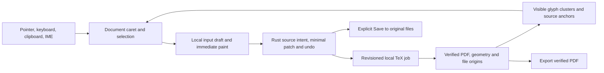

# Responsive editing on the typeset page

Decision, 25 November 2026. Keep the Windows Tauri shell and the user's local TeX engine. A click on visible editable prose must place a caret and accept the very next key, including when an earlier edit is still typesetting. Fast feedback and accurate final output have different deadlines.

## What Compositor demonstrates

The author's macOS implementation described a DVI page view that receives native text input. Its glyph hit test returns a source position with leading or trailing affinity. The source model owns text and selection. A document model connects it to TeX, a DVI parser and a structure parser. This is direct evidence for the historical design. The Windows release describes shared source-editor code and later release notes confirm incremental typesetting. The public material does not establish the current checkpoint format, invalidation algorithm, exact Windows event path, or latency percentiles. [Engineering article](https://compositorapp.com/blog/2018-09-29/Testing/) · [Windows editor](https://compositorapp.com/blog/2026-02-12/Compositor-Windows-05/) · [Incremental typesetting fixes](https://compositorapp.com/blog/2026-10-12/Compositor-Windows-092/)

The author also identified stale page snapshots as the cause of a historical source corruption bug. Editing an early page changed offsets used by a later one. A separate fix addressed glyphs whose displayed order differs from the order of their input commands, including author information and math scripts. Both observations support revision-bound source anchors. The 2017 font issue proposes snapshotting font state after a page, but does not establish how the current Windows engine stores a complete checkpoint. [Page snapshots](https://github.com/ktraunmueller/Compositor/issues/530#issuecomment-797501089) · [Source order](https://github.com/ktraunmueller/Compositor/issues/163) · [Font state](https://github.com/ktraunmueller/Compositor/issues/28)

The closest lessons come from failures. In November a Windows build updated the source while the page stayed frozen. Another left keyboard focus in the menu. Earlier builds had problems editing across a page boundary and preserving formatting on replacement. Put all four interactions in the packaged Windows suite. Preserve separate input files, the project's compiler and original Unicode. Compositor currently documents file flattening, a TeX Live 2018 package set and limits on non-Latin scripts. [Page refresh](https://compositorapp.com/blog/2026-11-20/Compositor-0111/) · [Keyboard focus](https://compositorapp.com/blog/2026-11-24/Compositor-0112/) · [Page boundary](https://compositorapp.com/blog/2026-08-27/Compositor-Windows-082/) · [Product limitations](https://compositorapp.com/#current-limitations)

## Where Texloom is today

In the previous candidate, ordinary prose could enter a one-page fast path. Formatting or a minipage sent the click through native SyncTeX lookups. The plain-text decoder rejected even a bold literal name. Changing the active passage could wait on a pending verification build. The old Windows executable refused the saved example name and took about 1.4 seconds to focus its final paragraph in one local run. This diagnoses the interaction. It is not a benchmark distribution.

The working implementation prepares source projections while PDF.js paints, indexes visible rows before publication, and edits a connected passage in WebView2. Rust checks a proposed source replacement against its original occurrence using the local compiler and PDFium. A minipage can contain several styled lines. This is a bridge to a document-wide caret. Pressing Backspace between independent environments, mixed-direction selections, tables and arbitrary generated output each need defined semantics and separate evidence.

## Retired workflows

The editable unit is a document position or text range. The earlier position inspector, selected-line frames, free dragging and offset-reset workflows have been retired from the backlog. Existing branches retain source transformations and tests that can serve document commands. The supported replacement for a frame-based deletion is Backspace or Delete at a caret or range. Enter inserts a paragraph. A structural move changes the order of paragraphs or list items. Visual spacing changes a paragraph or line-break parameter. The roadmap tracks these commands through #55–#58 and #64.

## Target architecture and ownership

1. **Positions outlive lines and pages.** Identify a position by project, file, revision, source anchor and affinity. Represent soft wraps, hard breaks, paragraph separators and environment boundaries explicitly. Store grapheme-to-glyph clusters and visual caret stops for each visible layout fragment. Use a spatial index per page, refreshed during publication, and a bounded cache around the viewport. For events on a mapped page the UI does a local lookup. A PDF page number or a match on displayed words alone cannot identify a source occurrence. Track visual and logical order separately for columns and bidi runs.
2. **One document selection survives reflow.** Source and typeset views use the same anchor transformations, undo groups and selection direction. Typing, deleting and moving the caret update the local draft immediately. Commit an IME composition as one operation and preserve uncommitted composition across view updates. Menus, dialogs, zoom, scrolling, accessibility focus and page recycling must restore the logical caret when input returns to the document. Tab inserts the defined document spacing while editing. Provide an accessible keyboard command for leaving the editing surface.
3. **Give every operation a source meaning.** For literal prose, replace only the selected bytes. For a local name macro, editing one rendered use preserves formatting, the definition and the other uses. A soft wrap has no source newline. An explicit line break or a paragraph separator can be removed by a join. Exiting a minipage, joining list items, formatting a heading and editing table cells require their own structural intents. Generated page numbers, running headers, references, repeated macros, ligatures and mathematical expressions need origin metadata or a visible control for the generating source. Never choose an occurrence by guesswork. Preserve included files, comments, whitespace, encodings and external-change checks.
4. **Schedule work by revision.** Each input session has a project ID, base revision, operation ID and sequence number. Keep one authoritative Rust document/history. Coalesce typing verification and prioritize visible pages. Superseded jobs may finish, but only matching revision, dependencies and selection provenance can change the displayed result. Rebase newer local edits and selections. Keep the last verified PDF on failure and the current draft available for correction. Auto Compile off lets the user type without scheduling ordinary compiles. Visual operations that require proof must identify pending verification separately. Export only the exact verified revision. Keep the deferred recovery feature dormant.
5. **Make rendering replaceable.** Keep the production local compiler for exact output. A layout provider returns fragment geometry, source origins, dependencies and a revision. Reuse unchanged pages when their identities and mappings match. A draft renderer may paint changed text immediately. A faster engine or worker can later implement the same interface. Isolate it so failure, cancellation or excess memory cannot take the editor down. Preserve the user's decision to keep preliminary full-page previews off.

## Delivery order

| Order | Deliverable | Evidence needed to advance |
| --- | --- | --- |
| Now · #60, #61, #32 | Ready-to-type Windows page with an instrumented input path | Real pointer and key events on the bundled signature and ordinary paragraphs. Prove focus, saved source, verified page, Undo, and ability to click another passage during verification. |
| Next · #46–#50, #62, #64 | Document-wide anchors and continuous editing across structure | Join and split in both directions, selection across a wrap/page/file, bold and local macros, RTL/Latin mixed text, grapheme clusters and IME composition. Every unsupported boundary has a predictable action. |
| Then · #51, #53, #54, #63, #67 | Revision-safe publication, paste, accessibility and viewport-scale indexing | Replay rapid edits, scroll and paste across reflow, cancel jobs, switch documents, simulate failed compilation and stale replies. Check keyboard focus and unchanged source outside the edit. |
| Experimental · #126 | Shorten verified layout time where measurements justify it | Compare against an ordinary clean compile. Differential evidence determines which optimization goes forward. |
| Product acceptance · #68 | Publish the supported capability and timing matrix on a named Windows candidate | Record remaining exclusions and regressions. Wider image, table, Home and styling work keeps its existing scope. |

## Test and performance contract

Use disposable 1-, 20- and 100-page projects, an included-file project, a package-heavy document and an Arabic/Hebrew/English fixture. Test cold open and warm typing separately. Record engine, fonts, package set, hardware, display scale, refresh rate, application build and workload. For a comparison with Compositor, use the same machine and mutually supported input, report both versions and separate product-coverage differences.

| Boundary | Proposed acceptance criterion |
| --- | --- |
| Press or click to local feedback | On a warmed mapped page at 60 Hz, target p95 within one 16.7 ms frame for handling, p95 within two frames for observable visual feedback. Report p50, p95, p99 and worst stall over at least 100 events per case. Measure handler, frame proxy and physical display separately. |
| Availability | First keystroke after a click reaches the clicked position, including during old verification. Zero compiler launches, SyncTeX subprocesses or synchronous backend round trips for an already mapped click. Check cold mapping cost and memory separately. |
| Verified output | Record time from last input to accepted source and settled PDF, page paint count and bytes transferred. Verify source, independent PDF text/geometry, neighboring content, page identity, links and Save/reopen. Collect tail latency and a full-build comparison. |
| Failure and scale | No lost or duplicated characters after focus changes, Ctrl+Z, cancellation, rapid A→B→A changes or failed builds. Exercise blank documents, empty selections, deleting all text, copy/paste, Tab, complex glyphs, missing packages, external changes and old render replies. For long files, measure cache bounds and time to edit a newly visible page. |

## Which compiler experiments deserve engineering time?

- **Preamble cache.** Texloom already measured five matched pairs on each of two MiKTeX pdfLaTeX fixtures. Median paired savings were 44 ms for plain text and 830 ms for a TikZ article across two compiler processes. A stale format printed the old macro value. A cache key needs both format-generation and document-pass dependencies, engine identity, arguments, relevant environment, fonts and package files. Miss or validate on change. [Texloom measurements](../../research/report/sections/compile-cost.tex) · [mylatexformat](https://ctan.org/pkg/mylatexformat)
- **XDV and an isolated engine worker.** Separately benchmark PDF finishing, transport and painting before adding another renderer. XeTeX can emit XDV. A parser still needs a font, glyph, special, image, link and source-origin implementation. Tectonic serializes its engine invocations within a process. Test worker restarts, cancellation, local packages, fonts and output agreement with the project's selected engine. [XeTeX](https://ctan.org/pkg/xetex) · [XDV parser](https://docs.rs/tectonic_xdv/latest/tectonic_xdv/) · [Tectonic engine contract](https://docs.rs/tectonic_engine_xetex/latest/tectonic_engine_xetex/struct.TexEngine.html)
- **Checkpointed typesetting.** TeXpresso's upstream documents a modified XeTeX, incremental driver, MuPDF and tests on Linux/macOS. A Windows/Wasm worker is a separate feasibility question. A resumable checkpoint must include engine memory, file and font state, expansion state, pending floats/inserts, auxiliary outputs and external inputs. A change on page 50 can affect earlier references and all later pages. Restore before the earliest affected dependency, propagate to verified convergence or run the full job. Test crash cleanup, memory growth, bibliography, contents, counters and pagination changes. [TeXpresso upstream](https://github.com/let-def/texpresso)
- **Decision rule.** The attachment's cost percentages, universal compatibility and 15–300 ms estimates have no measurements on Texloom's desktop pipeline. Start with the measured bottleneck. Adopt an optimization only when source targeting and output equivalence pass its corpus and the improvement remains material at p95 under the agreed memory budget. A parity claim requires a same-machine comparison.
