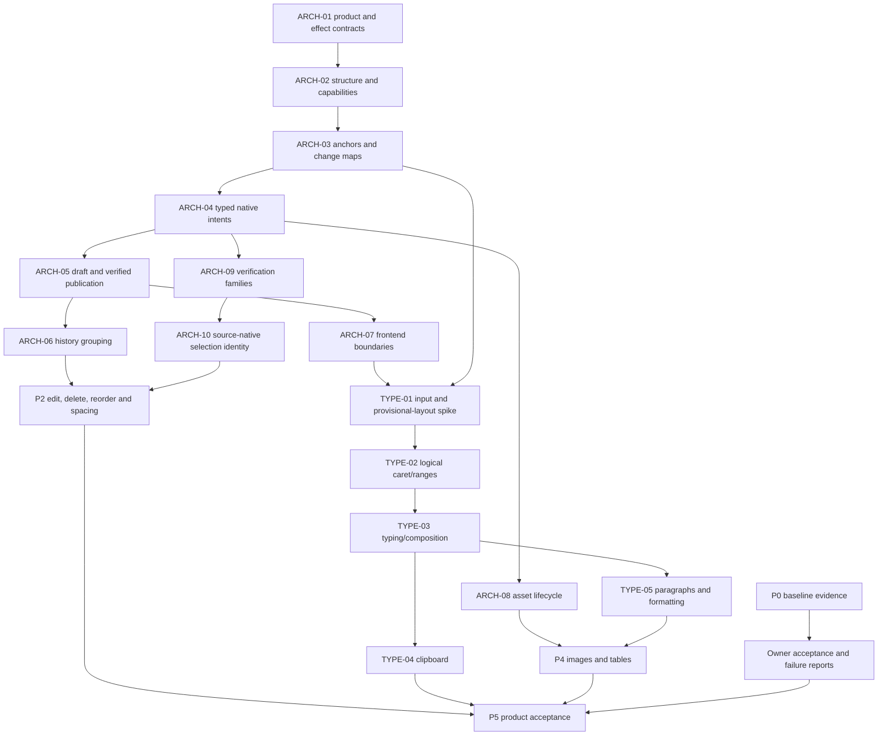

# Roadmap to the intended visual authoring product

Planning baseline: 7 November 2026, application source `6f55bac`. This is a dependency-ordered roadmap with acceptance gates, not a dated promise, an implementation approval or a declaration that the current application has these features. [Architecture](ARCHITECTURE.md), [evidence](STANDARDS-AND-EVIDENCE.md) and [decisions](DECISIONS.md) explain the reasoning.

## 1. Intended product and explicit completion boundary

The intended first full visual-authoring version lets a user open a supported LaTeX project, navigate and select supported content visually, edit/delete/reorder it, adjust spacing/formatting, place a caret and add text in flow, cut/copy/paste, and work with supported images and tables. All accepted edits appear as understandable source changes with coherent Undo/Redo, draft protection, Save/reopen and external compilation. Keyboard, pointer and accessible alternatives reach the same commands.

"Word-like" describes familiar authoring interactions, responsiveness, recoverability and navigation. It does not promise the DOCX file format, perfect Microsoft Word parity or visual inversion of arbitrary TeX. Unknown source remains intact and source mode remains available. New source-native edits avoid Texloom-specific saved macros/packages; ordinary project dependencies remain.

Current English/Arabic/Hebrew support must carry into the new editing path. Other languages and CJK IMEs remain later scope. Free-floating positioning is not a required new authoring mode. Old positioned projects still need compatibility.

The proposed final capability matrix must be reviewed in ARCH-01. Images/tables, headings/lists and richer formatting are planned families with explicit supported subsets, not a promise that every existing macro/environment can be edited. Collaboration, cloud sync, DOCX interchange, track changes, mail merge, unrestricted equations/TikZ/custom macros, and generalized cross-page drawing are not silently included. Future owner requests can create another roadmap increment.

## 2. Current baseline and what to retain

The bounded editing app already has canonical native sources/history, guarded draft edits, candidate builds, independent inspection, exact-source Undo, recovery, bounded parameter adapters and source/PDF interaction. Legacy positioned blocks can be inserted/deleted; ordinary text objects can be edited/moved. These are useful foundations, not a complete visual text editor.

Prepared r8 still needs owner acceptance. Existing issues #26–#31 track exact installation, multilingual interaction, recovery, corrected compilation and supported workflow/portability. #32–#36 track performance, wider Windows, dependency and usability/release work. #37–#39 track a fixed-version research evaluation. #40/#41/#43 are closed bounded implementation tasks; their closure does not close later source-native or Word-like acceptance.

Retain named-version evidence and failed cases. Do not rerun all historical checks without a reason. Do not claim that 291 frontend/88 core/40 helper regressions measure application accuracy or validate future operations.

## 3. Stages and gates

| Stage | Deliverable | Exit gate | Related backlog |
| --- | --- | --- | --- |
| P0: baseline and decisions | Preserve a known baseline; decide the product/capability/output contract and risk priorities | Current failures/pending tests remain visible; proposed source-native semantics reviewed | Existing #26–#31; ARCH-01; early TYPE-01 design |
| P1: extensible foundation | Partial lossless structure, anchors, typed intents, two editing lifecycles, shared history, modules, assets and verification policies | New operations can be added without a second document/history owner; stale/ambiguous operations refuse | ARCH-02–ARCH-10; TYPE-01 feasibility spike can run once prerequisites exist |
| P2: complete source-native manipulation | Visual replacement, Delete, reorder and native spacing; legacy compatibility/migration | A supported paragraph/signature workflow edits/deletes/moves/undoes/saves/reopens without adding a Texloom support dependency | CORE-01–CORE-05 |
| P3: visual text authoring | Logical caret/range navigation, controlled input/composition, insertion and safe clipboard | Supported text can be inserted/replaced/deleted continuously while draft recovery and background rendering remain correct | TYPE-01–TYPE-04 |
| P4: document structure and objects | Paragraph split/join, headings/lists, supported formatting, images and table content | Each declared object family has edit/insert/delete/reorder and source/asset/history contracts appropriate to it | TYPE-05; OBJECT-01/02 |
| P5: intended-product acceptance | Accessible workflows, measured responsiveness, scale/reliability/portability and actual Windows acceptance | Complete declared capability matrix, no unresolved blocking data-loss/correctness defect, recorded limitations and owner acceptance | QUALITY-01/02 plus existing #31–#36 |
| Research track | Methods/inventory now; fixed-version measurement after a chosen stable scope | Independent version/fixture/oracle review, preserved failures, measured results and modest claims | Existing #37–#39; ARCH-09 |

No new milestone has an invented date. Scheduling follows observed effort and available testing equipment. "Final" means this reviewed product scope passes its gates; it does not mean no future features or maintenance.

## 4. Dependency and parallel-work plan

The diagram is a critical dependency overview; the structured backlog is the detailed dependency source. Source-model/operation design and current-build owner checks can proceed in parallel. Frontend extraction can progress after interfaces are settled without waiting for every future adapter. Accessibility design begins in P1; its actual product acceptance is in P5. The risky caret/input feasibility study should happen early enough to change the design, not after all object features are built.

No task may bypass prerequisites by assigning itself a generic Semantic verification label. Baseline acceptance does not require postponing all architecture work; it does require keeping regressions/failures visible before adopting a replacement.

## 5. First implementation sequence after authorization

1. Review ARCH-01 and the open decisions. Define what Delete, reorder, spacing adjustment and source-native output mean. Identify the first recognized text units and explicit unsupported cases.
2. Build a minimal ARCH-02/03/04 contract slice around the existing canonical document. Prove range mapping/invalidation, operation preconditions and source-preserving plans with synthetic cases.
3. Establish ARCH-05/06 history and lifecycle rules before adding another input surface. Extract only the ARCH-07 ownership boundaries needed by the slice.
4. Define ARCH-09 verification for exact deletion, intended new order with content conservation, declared spacing/reflow and bounded dependent/generated-output changes. Investigate ARCH-10 identity without persistent saved wrappers.
5. Deliver one P2 vertical slice for ordinary paragraphs and bounded signature groups: select, replace, Delete, reorder or adjust a recognized gap, Undo/Redo, Save/reopen and compile externally.
6. Run TYPE-01 against actual input/preview constraints before committing to a host API. Then implement caret and typing against the same source/history authority.

ARCH-08 is designed early; full media behavior is enabled only with transactional asset semantics. Existing legacy import behavior is not represented as already providing those guarantees.

## 6. Acceptance and evidence strategy

For each operation, predeclare source postconditions, allowed render effects, supported contexts, refusal rules and performance endpoint. Use both successful cases and targeted wrong-occurrence/collateral-change controls. Keep correctness, usability and performance results separate.

Required families include repeated text, comments/macros/scopes, incomplete source, included files, BOM/CRLF/Unicode offsets, English/Arabic/Hebrew, combining marks/graphemes, mixed directions, three supported engines where applicable, failed compiles, superseded jobs, uncertain acknowledgements, external modifications, Undo/Redo, recovery, shared assets and external compilation. Composition/input behavior must be tested with the actual available OS/runtime; no added Windows input languages or fictitious IME passes.

Tests progress from pure domain contracts to real-engine/independent inspection, then actual packaged Windows interaction and human tasks. The owner controls app-opening/input/install tests. Synthetic DOM tests do not establish focus/IME/screen-reader behavior on Windows. Another monitor or clean environment being unavailable remains an unrun gate.

The first visual typing release needs an observed input-feedback/render-catch-up strategy. Latency gates must name measured endpoints and workloads; a two-frame callback proxy is not physical presentation. Retain failed/censored samples, workload budgets and ordinary-versus-diagnostic overhead. No guarantee of compile-per-keystroke instantaneous PDF output is made.

## 7. Portability, migration and deployment

New saved source-native operations must work without Texloom macros/support files in the declared test projects. This does not remove normal packages/assets/fonts. External compilation uses recorded engines and fixtures; no user documents are uploaded to external services for testing.

Existing wrapped/positioned projects open without silent conversion. Convert on a protected copy or explicit reviewed transaction, verify equivalence or disclose changed layout, preserve customized styles and dependencies still in use, and support rollback. Deleting content must not be confused with deleting its placement wrapper or shared media bytes.

A private release candidate needs the relevant old Windows gates plus new authoring workflow tests. The owner intends to keep the repository private now and in the future; public distribution, Store submission and associated signing work are outside this roadmap. Internal installation/updates still need project-preservation and artifact-identity checks. Dependency provenance and process supervision are not blanket safety certification.

## 8. Research runs and future revisions

The report/evidence inventory continues alongside development. A stable bounded source-native version may be frozen and evaluated before every future Word-like feature exists; the study must name that narrower scope. A later visual-typing/object release needs a new fixed version and separately declared evaluation. Do not silently generalize the old wrapper displacement results to new reflow or caret operations.

Existing development cases remain development cases. Review final labels/oracles independently, seal manifests before execution, preserve rejected/failed/unresolved cases and restart with a separately versioned run after product fixes. The current final-study freeze remains `not_frozen`.

## 9. Completion checklist for the intended first full version

- [ ] Reviewed capability matrix covers selected text, paragraphs/groups, supported formatting, images and tables; unsupported structures are accurately represented.
- [ ] Visual selection/caret, replace, Delete, reorder, spacing and insertion behave consistently across input methods and shared history.
- [ ] Plain-text entry/paste is context-safe; composition, grapheme deletion and bidi navigation preserve intended source.
- [ ] Source-native output, old-project compatibility and explicit migration meet the declared policy.
- [ ] Save/reopen, recovery, external edits and asset references survive the declared failure cases without silent loss.
- [ ] Actual owner-run Windows, keyboard/assistive-technology and non-drag pointer workflows have recorded outcomes.
- [ ] Performance/scale budgets and clean-setup/portability/dependency gates have scoped evidence; unavailable cases remain unresolved.
- [ ] Research claims apply only to fixed measured versions. Private delivery is accepted; public distribution/Store work is excluded and no report publication/submission is implied.

The roadmap is complete as a planning artifact when all these workstreams have actionable tasks and dependencies. The product is complete only when its declared acceptance is actually observed.
